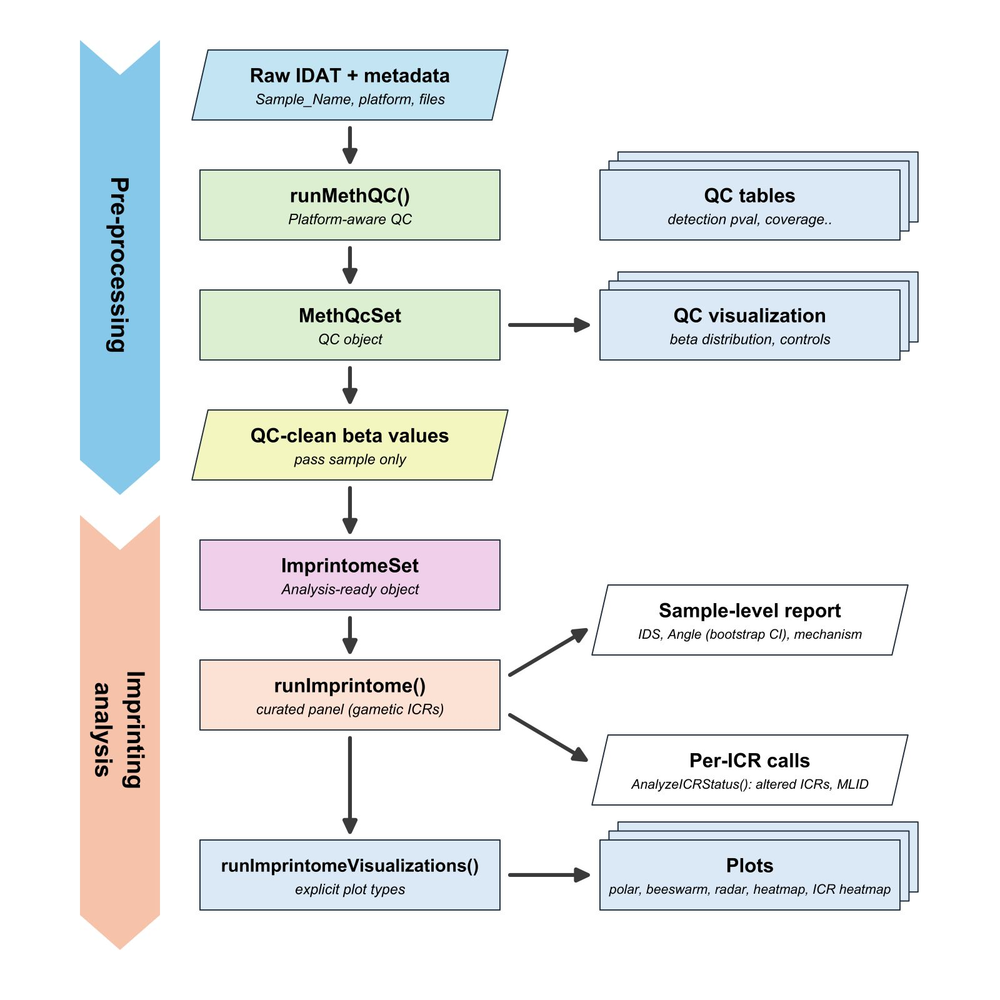

<h1>imprintomeR</h1>

[](https://doi.org/10.5281/zenodo.23741652)

imprintomeR measures and visualizes genomic imprinting disturbance from Illumina 450K, EPICv1 and EPICv2 methylation arrays. Starting from IDAT files, it runs quality control (QC) and preprocessing, then scores each sample at imprinting control regions (ICRs):

- **Scores:**
  - The Imprinting Deviation Index (IDI), (β − 0.5) × 2, places each probe on a −1 to 1 scale, where 0 is the half-methylated state expected at an ICR.
  - From the paternal and maternal deviations, the Imprinting Deviation Score (IDS) gives each sample's overall deviation, and the Angle gives its direction. Bootstrap confidence intervals are optional.
- **Per-ICR calls:** each ICR is scored on its own, with a multi-locus summary per sample.
- **Reference centring:** scores can be centred on control samples from the same study.
- **Plots:** polar plots (IDS and Angle), radar plots (median IDI per ICR), rainfall plots (IDI per probe), beeswarm plots and per-ICR heatmaps.

The workflow is built on two S4 classes:

- **MethQcSet:** QC results and preprocessed data for one array platform.
- **ImprintomeSet:** scores and annotations, ready for analysis and plotting.

Every step can be run from R or with the command-line scripts in `inst/scripts/` (see the [command-line guide](vignettes/imprintomeR_cli_README.md)).

## Table of Contents

- [Installation](#installation)
- [Quick start](#quick-start)
- [Architecture: Preprocessing-First Workflow](#architecture-preprocessing-first-workflow)
- [Core Formulas](#core-formulas)
  - [Angle Direction Mapping](#angle-direction-mapping)
- [Bundled probesets](#bundled-probesets)
- [Recommended Workflow](#recommended-workflow)
  - [Step 1: QC Preprocessing (MethQcSet)](#step-1-qc-preprocessing-methqcset--optional-if-data-already-cleaned)
  - [Step 2: Create Analysis Container (ImprintomeSet)](#step-2-create-analysis-container-imprintomeset)
  - [Step 3: Run Imprinting Analysis](#step-3-run-imprinting-analysis)
    - [Reference centring and Infinium design types](#reference-centring-and-infinium-design-types)
    - [Per-ICR scores and ICR-balanced IDS](#per-icr-scores-and-icr-balanced-ids)
    - [Uncertainty and calibration](#uncertainty-and-calibration)
  - [Step 4: Summarize, Visualize, Export](#step-4-summarize-visualize-export)
- [Detailed Examples](#detailed-examples)
  - [MethQcSet: Platform-Specific Preprocessing](#methqcset-platform-specific-preprocessing)
  - [Inspecting the objects](#inspecting-the-objects)
- [Visualization](#visualization)
  - [Available Plot Types](#available-plot-types)
  - [Standard Workflow Plots](#standard-workflow-plots)
  - [Example Plots](#example-plots)
- [Export QC Results](#export-qc-results)
- [MCP Server](#mcp-server)
  - [Local Setup](#local-setup)
- [Agent Skill](#agent-skill)
- [Test Suite](#test-suite)
- [Vignettes](#vignettes)
- [Maintainers](#maintainers)
- [Contact](#contact)
- [SessionInfo](#sessioninfo)

## Installation

Install the latest development version:

```r
# Using devtools
devtools::install_github("hongjianjin/imprintomeR")

# Or from local source
devtools::install("path/to/imprintomeR")
```

The QC dependency [ewastools](https://github.com/hhhh5/ewastools) is not on CRAN; both commands install it
from GitHub automatically (DESCRIPTION `Remotes: hhhh5/ewastools`).

The annotation files (about 52 MB) are installed with the package, under `inst/extdata/`:
- `anno.uniq_harmonized.liftover.rds`: CpG probe coordinates and annotations (hg19 and hg38);
- `probesets_hg19.rds` and `probesets_hg38.rds`: probe panels for imprinting control regions (ICRs).

If any of them is missing, imprintomeR prints a note when it loads; download them from the `main` branch of this repository with:

```r
library(imprintomeR)
setup_imprintome_data()
```

hg38 (GRCh38) is the default reference genome throughout: `as.ImprintomeSet()`, `AnalyzeImprintStatus()`, `SubsetBeta_By_Probeset()`, `AggregateByLocus()`, and the CLI `--genome` option all default to `"hg38"` and load `probesets_hg38.rds`. `runImprintome()` uses the genome stored in the `ImprintomeSet`. Pass `genome = "hg19"` (or `--genome hg19`) for GRCh37 coordinates. Probe IDs, parental-origin labels, and `DMR_type` are the same in both builds for every probe-level panel except `Jima` (two extra probes in hg38), so scores do not depend on the build.

## Quick start

```r
library(imprintomeR)

# 1. QC, one array platform at a time
meta  <- LoadMeta("meta.tsv")         # Sample_Name, Sample_Group and Basename (IDAT path prefix)
meta  <- check_platform(meta)         # adds the Platform column
qcset <- runMethQC(meta[meta$Platform == "EPIC", ], outdir = "qc_output", prefix = "epic")
export(qcset, outdir = "qc_output", prefix = "epic", format = c("xlsx", "rds"))   # QC report, all samples

# 2. Imprinting analysis (in a later session: qcset <- readRDS("qc_output/data/epic_qcset.rds"))
qcset <- subsetMethQC(qcset, final_qc = "PASS")   # keep samples that passed QC
# EPICv2 only: qcset <- aggregate_probes(qcset)
x <- as.ImprintomeSet(qcset)          # bundled hg38 panels
x <- runImprintome(x, probeset = "selected")

# 3. Plot and export
plot(x, plot_type = "polar", outFile = "polar.pdf")
export(x, outdir = "imprintome_results", prefix = "study", save_plots = TRUE)
```

Each step is described in the [Recommended workflow](#recommended-workflow).

## Architecture: Preprocessing-First Workflow

Raw methylation arrays often come from mixed platforms (450K, EPICv1, EPICv2). The **MethQcSet** container isolates QC processing for a single platform, preventing silent data corruption from cross-platform merging. In code, `check_platform()`, `runMethQC(platform = )` and the `Platform` column use the values `"450K"`, `"EPIC"` (EPICv1) and `"EPICv2"`.

<p align="center">
  
</p>

```
Metadata + IDAT files (one or more platforms)
    ↓
[check_platform(meta)] → detect the array platform of each sample
    ↓
Subset meta by platform
    ↓
[runMethQC(meta_platform)] → read IDATs → normalize beta (noob by default) + detection p-values
                           → QC metrics, Final.QC PASS/FAIL per sample → MethQcSet
    ↓
[subsetMethQC(qcset, final_qc = "PASS")] → keep passing samples
    ↓
[aggregate_probes(qcset)] → EPICv2 only: collapse replicate probes (required)
    ↓
[as.ImprintomeSet(qcset)] → ImprintomeSet with the bundled panels (hg38 by default)
    ↑
    └── or ImprintomeSet(beta, meta, ...) for data already QC-cleaned elsewhere
    ↓
[runImprintome()] → IDS, Angle and Mechanism per sample
                  (+ per-ICR calls and multi-locus summary with icr = TRUE;
                     bootstrap intervals with n_boot)
    ↓
[plot() / export()] → plots and result tables
```

## Core Formulas
- Imprinting Deviation Index (**IDI**): (beta - 0.5) × 2
- Imprinting Deviation Score (**IDS**): √((paternal_median - 0.5)² + (maternal_median - 0.5)²)
- **Deviation Angle**: atan2(maternal_median - 0.5, paternal_median - 0.5)
- With a control reference, 0.5 is replaced by each probe's median beta across the controls: paternal/maternal deviations are medians of (beta − reference), and IDS and Angle are computed from these deviations (see [Reference centring and Infinium design types](#reference-centring-and-infinium-design-types)).

Subtracting 0.5 moves the hemimethylated state of an imprinting control region to the origin (0, 0) of a plane whose axes are the paternal and maternal median deviations. Each sample is then a deviation vector: IDS is its length, the Euclidean distance from balanced imprinting, and Angle its direction. Without the shift, distance and direction would be measured from a fully unmethylated locus. IDI applies the same shift probe by probe and rescales it to [−1, 1].

The paternal and maternal classes come from the probeset's `ORIGIN` annotation, and array beta values are bulk, not allele-specific, measurements. IDS and Angle are therefore descriptive summaries along the annotated parental axes, not parent-of-origin calls. The default IDS cutoff (0.2) and confidence tiers (0.1/0.2/0.4) are exploratory screening conventions; calibrate them on tissue-matched controls where possible (see [Uncertainty and calibration](#uncertainty-and-calibration)).

### Angle Direction Mapping
Each 45-degree sector of the polar plot is labelled with the direction of shift along the annotated paternal and maternal axes, such as paternal gain or maternal loss of methylation, or global hypo- or hypermethylation. Each label covers the 45° sector centred on the angle in the table (for example, Pat-Gain covers 337.5° to 22.5°). Samples with IDS < 0.2 are labelled ROI (retention of imprinting). The labels are exploratory directional summaries of bulk beta values, not parent-of-origin molecular calls; with `n_boot`, `Mechanism_support` reports how stable a sample's label is under resampling.

| Angle (°) | Sector (°) | `Mechanism` label |
|---:|---|---|
| 0 | 337.5 – 22.5 | `Pat-Gain` |
| 45 | 22.5 – 67.5 | `Global-Hyper` |
| 90 | 67.5 – 112.5 | `Mat-Gain` |
| 135 | 112.5 – 157.5 | `Mat-Gain+Pat-Loss` |
| 180 | 157.5 – 202.5 | `Pat-Loss` |
| 225 | 202.5 – 247.5 | `Global-Hypo` |
| 270 | 247.5 – 292.5 | `Mat-Loss` |
| 315 | 292.5 – 337.5 | `Pat-Gain+Mat-Loss` |

## Bundled probesets

`probesets_hg19.rds` and `probesets_hg38.rds` contain the same eleven panels in the same order: the probe-level `Jima`, `Joshi`, `Court`, `Rosenski`, `selected` (782 probes, selected on 450K and EPICv1 and/or EPICv2: all 782 on 450K, 742 on EPICv1, 683 on EPICv2), `NanoImprint`, `chr11p15` and `chr20q13` (GNAS) panels, and the region-level `Rosenski_region`, `chr11p15_region` and `chr20q13_region` panels. Every probe-level panel carries parental-origin (`ORIGIN`) labels, an `ICR_name` and a `DMR_type` (gametic, secondary, ambiguous or uncurated) following Monk et al. (2018), and the Infinium design type of each probe. Probe coordinates come from `anno.uniq_harmonized.liftover.rds`, which merges the Illumina 450K, EPIC v1.0 B5 and EPICv2 manifests; its chromosome labels were checked against the UCSC hg19ToHg38 and hg38ToHg19 chains.

The `selected` panel is built from four source panels:

| Source panel | Probes (hg38) | Derived from |
|---|---:|---|
| `Court` (Court et al., 2014) | 1,027 | regions mapped to array probes by coordinate overlap in hg19 |
| `Jima` (Jima et al., 2022) | 1,835 | candidate ICRs (Supplementary Table S1) mapped by coordinate overlap in hg38 |
| `Joshi` (Joshi et al., 2016) | 844 | 450K probe identifiers reported by the study |
| `Rosenski` (Rosenski et al., 2025) | 1,050 | regions mapped by coordinate overlap in hg19 |

The source catalogues come from whole-genome bisulfite sequencing and/or 450K methylation profiling. Each panel was carried to the other genome build by probe identifier using `anno.uniq_harmonized.liftover.rds`. Probe membership is the same in hg19 and hg38, except two Jima probes without an hg19 coordinate. Together the four panels contain 2,724 distinct probes.

`selected` keeps the 868 probes present in at least two of the four panels and, of these, the 782 that are on the 450K array and on EPICv1 and/or EPICv2. The 86 excluded probes are 17 found only on 450K and 69 found only on EPICv1 and/or EPICv2. Selection is probe-based, so ICRs were not chosen individually. The submitted manuscript used earlier source panels (808 probes in at least two panels; 606 selected).

Platform coverage of the 782 `selected` probes, from the `ASSAY` column of `anno.uniq_harmonized.liftover.rds` (`EPICV10b5` is EPICv1, the EPIC v1.0 B5 manifest). Every probe is on 450K and on EPICv1, EPICv2 or both:

| `ASSAY` value | 450K | EPICv1 | EPICv2 | Probes |
|---|:---:|:---:|:---:|---:|
| `450K,EPICV10b5,EPICV2` | ✓ | ✓ | ✓ | 643 |
| `450K,EPICV10b5` | ✓ | ✓ | | 99 |
| `450K,EPICV2` | ✓ | | ✓ | 40 |
| **Probes on each array** | **782** | **742** | **683** | **782** |

## Recommended workflow

### Step 1: QC Preprocessing (MethQcSet) — Optional if Data Already Cleaned

**If you have RAW data:**

`meta.tsv` must be a tab-delimited file with at least `Sample_Name` and `Sample_Group` columns.

**For QC workflow (Option A — raw IDAT files):** also include `Basename` column (full path prefix to IDAT files).

**For direct analysis (Option B — QC already done externally):** `Basename` is not needed; just `Sample_Name` and `Sample_Group` suffice.

Additional columns (e.g., sex, diagnosis) are carried through and available for plotting.

```
Sample_Name    Basename                                   Sample_Group    SEX
SampleA        /data/idats/202301234567_R01C01            Control         F
SampleB        /data/idats/202301234567_R02C01            Case            M
SampleC        /data/idats/202301234568_R01C01            Control         F
SampleD        /data/idats/202301234568_R02C01            Case            M
```

> `Basename` must be the full path prefix to the IDAT files, i.e. the path without `_Red.idat` / `_Grn.idat`.

```r
library(imprintomeR)

# Load metadata (requires Basename column with IDAT path prefixes)
meta <- LoadMeta("meta.tsv")

# Option A: platform unknown or mixed — detect first
meta <- check_platform(meta)   # reads IDAT probe counts; appends Platform column
table(meta$Platform)           # inspect; split if multiple platforms present

meta_epic <- meta[meta$Platform == "EPIC", ]
# meta_epic looks like:
#   Sample_Name    Basename                              Sample_Group    SEX    Platform
#   SampleA        /data/idats/202301234567_R01C01        Control         F      EPIC
#   SampleC        /data/idats/202301234568_R01C01        Control         F      EPIC
qcset <- runMethQC(meta_epic)  # platform auto-resolved from meta$Platform

# QC plot/report PDFs are written by default:
#   epic_QC_detection_pval.pdf and epic_QC_probe_coverage.pdf in qc_output/
#   epic_QC_minfiDensity_all.pdf in qc_output/ (raw minfi RGChannelSet)
#   epic_QC_intensity.pdf, epic_QC_betaDensity_all/pass/fail.pdf,
#     and epic_QC_minfiDensity_pass/fail.pdf in qc_output/plots/
# qcset <- runMethQC(meta_epic, outdir = "qc_output", prefix = "epic")
# Use save_qc_report = FALSE to suppress default QC plot/report PDFs.

# Beta normalization (default "noob"; also "noob_swan", or "raw" as in earlier versions).
# The method is recorded in qc_params(qcset)$normalization.
# qcset <- runMethQC(meta_epic, normalization = "noob_swan")

# Option B: platform already known
# qcset <- runMethQC(meta, platform = "EPIC")

# Inspect QC results
qc_summary <- qc_summarize(qcset)
str(qc_summary)
# $qc_status : table of Final.QC PASS/FAIL counts
# $qc_tables : names of populated qc_tables keys

# Access QC_matrix directly
qc_matrix <- qc_tables(qcset)[["QC_matrix"]]
table(qc_matrix$Final.QC)

# Visualize QC metrics (all plot() calls return a ggplot2 object)
p_bar  <- plot(qcset, type = "qc_bar",          outFile = "qc_bar.pdf")          # PASS/FAIL bar chart (default)
p_int  <- plot(qcset, type = "intensity",        icutoff = 11,
               outFile = "qc_intensity.pdf")                                       # mMed vs uMed scatter
p_dp   <- plot(qcset, type = "detection_pval",   pcutoff = 0.05,
               outFile = "qc_aveDetPval.pdf")                                    # avg detection p-val per sample
p_den  <- plot(qcset, type = "beta_density",      sample_set = "all",
               outFile = "qc_beta_density_all.pdf")                              # beta-value density per sample
p_cov  <- plot(qcset, type = "probe_coverage",   outFile = "qc_probe_coverage.pdf") # % probes detected per sample
p_sex  <- plot(qcset, type = "predicted_sex",    outFile = "qc_predicted_sex.pdf")  # predicted sex distribution
p_ctrl <- plot(qcset, type = "ctrl_metrics",         outFile = "qc_ctrl_matrix_summary.pdf")   # ewastools scores
plot(qcset, type = "ctrl_metrics_detail",            outFile = "qc_ctrl_matrix_detail")         # per-metric PDFs (Bisulfite/Specificity)

# Export cleaned data: two workbooks ({prefix}_qc_table_main.xlsx and
#   QC_tables/{prefix}_qc_table_extra.xlsx) and data/{prefix}_qcset.rds
#   (see Export QC Results)
export(qcset, outdir = "qc_output", prefix = "epic", format = c("xlsx", "rds"))
```

**QC pass criteria.** A sample is `Final.QC = "PASS"` when both hold:

1. at least 95% of probes are detected at p < `pcutoff` (default 0.05, i.e. `pctDetectedCpG_dP0.05 >= 95`; set it with `runMethQC(..., pcutoff = 0.01)` or `run_meth_QC.R --pcutoff 0.01`; detection p-values from `minfi::detectionP()`);
2. `CtrlMetrics.QC` is PASS, which means that the ewastools Bisulfite Conversion I Green and Red control metrics are both at least 1. If the ewastools step cannot run (or `run_meth_QC.R --skip-ewastools` is used), only criterion 1 applies.

All other values are reported for review and do not affect `Final.QC`: the other control metrics (staining, extension, hybridization, specificity and so on), median intensities, predicted sex, SNP contamination and predicted donor IDs. `subsetMethQC(qcset, final_qc = "PASS")` keeps the passing samples.

> **Already have QC-cleaned data?** Skip to [Step 2 Option B](#step-2-create-analysis-container-imprintomeset) and construct `ImprintomeSet` directly from `beta` + `meta`.

Key MethQcSet features:

- **Platform validation**: Prevents mixing 450K, EPICv1 and EPICv2
- **QC metrics**: Detection p-values, intensity summaries (mMed/uMed/aveMed merged into `QC_matrix`), probe coverage
- **Default QC plot/report PDFs**: `runMethQC(..., outdir = "qc_output", prefix = "epic")` writes, unless `save_qc_report = FALSE`:
  - review PDFs in `outdir`: `{prefix}_QC_detection_pval.pdf`, `{prefix}_QC_probe_coverage.pdf`, `{prefix}_QC_minfiDensity_all.pdf`;
  - report PDFs in `outdir/plots/`: `{prefix}_QC_intensity.pdf`, `{prefix}_QC_betaDensity_all/pass/fail.pdf`, `{prefix}_QC_minfiDensity_pass/fail.pdf`.
- **Beta normalization** (`runMethQC(..., normalization = )`; CLI `run_meth_QC.R --normalization`):
  - `"noob"` (default): minfi noob background and dye-bias correction;
  - `"noob_swan"`: adds SWAN type I/II adjustment (fixed seed, reproducible);
  - `"raw"`: unnormalized beta.

  All three normalize each sample on its own and work on 450K, EPICv1 and EPICv2. Detection p-values, intensities and predicted sex always use unnormalized data. The method is stored in `qc_params(qcset)$normalization` and carried into `BuildReferenceProfile()` profiles; use the same method for cohorts and the reference profiles they are centred on. EPICv2 needs the `IlluminaHumanMethylationEPICv2manifest` and `IlluminaHumanMethylationEPICv2anno.20a1.hg38` packages (Bioconductor >= 3.19); `runMethQC()` sets the EPICv2 minfi annotation automatically, because earlier minfi releases do not recognize the array.
- **Canonical `qc_tables` keys** (populated by `runMethQC()`):
  - `QC_matrix` — per-sample detection stats, intensity, predictedSex, `Final.QC`. `Final.QC` is PASS when at least 95% of probes are detected at p < `pcutoff` (default 0.05) and, when the ewastools control metrics are available, `CtrlMetrics.QC` is PASS. `CtrlMetrics.QC` fails only on Bisulfite Conversion I Green or Red below 1; the other control metrics are reported, not used.
  - `recall_rate` — per-probe % detected across all / PASS / FAIL samples
  - `cutoffs` — QC threshold criteria with Pass/Fail expressions (probe detection required; intensity and mean detection p-value reported only; control metrics when available)
    - **Core metrics (3 rows):** log2MedianIntensity (reported only), aveDetectionPval (reported only), `pctDetectedCpG_dP<pcutoff>` (>= 95; required)
    - **SNP metrics (1 row):** snps_outliers_aveLogOdds (>-4)
    - **Control metrics (18 rows, from ewastools):** Restoration, Staining, Extension, Hybridization, Target_Removal, Bisulfite_Conversion, Specificity, Non-polymorphic
    - **Columns:** criteria, cutoff, Pass, Fail, Final.QC, CtrlMetrics.QC
    - **Conditional formatting:** Use `SaveTableStyle()` (from `openxlsx`) with `condFmt` parameter to highlight Pass/Fail expressions in Excel exports
  - `ctrl_metrics` — control probe metrics (from ewastools)
  - `contamination` — SNP agreement / sample-swap check (from ewastools)
  - `predUniqDonor_ID` — predicted unique donors per sample group (from ewastools)
- **EPICv2 aggregation required**: Replicate probes (e.g. `cg..._TC11`, `cg..._TC12`) must be collapsed to base probe IDs before conversion — `aggregate_probes()` is a required step for EPICv2 (`as.ImprintomeSet()` will error if skipped)
- **Merge operations**: Synchronized metadata/beta alignment (`merge()`)
- **Export workflow**: Write QC tables, beta values, metadata to disk (`export()`)

### Step 2: Create Analysis Container (ImprintomeSet)

Once QC-approved, convert to analysis-ready object:

```r
probesets <- readRDS(system.file("extdata", "probesets_hg38.rds", package = "imprintomeR"))

# Option A: convert from a MethQcSet (recommended — carries platform/assay automatically)

# EPICv2 only: aggregate replicate probes first (required)
# as.ImprintomeSet() will error if this step is skipped for EPICv2.
if (qcset@platform == "EPICv2") {
  qcset <- aggregate_probes(qcset)  # ~937k → ~865k unique base probes (median of each replicate group)
  qc_tables(qcset)$Aggregation_report # replicate groups collapsed, unchanged and malformed IDs, all-missing values
}

x <- as.ImprintomeSet(
  qcset,
  probeset = probesets[["selected"]],
  genome = "hg38"                      # default; "hg19" for GRCh37 coordinates
)

# Option B: build directly from beta + meta (QC already done externally)
# Note: Basename column is not needed since QC step is skipped
meta <- LoadMeta("meta.tsv")  # Only needs Sample_Name and Sample_Group
beta <- LoadBeta("cleaned_beta.tsv")   # probes × samples matrix, already QC-filtered

x <- ImprintomeSet(
  beta    = beta,
  meta    = meta,
  probeset = probesets[["selected"]],
  genome  = "hg38",
  assay   = "EPIC"                     # "450K" | "EPIC" (or "EPICv1") | "EPICv2"
)

# Either way, x is ready for analysis
# x now contains: beta, meta, probeset, genome, assay
```

### Step 3: Run Imprinting Analysis

```r
x <- runImprintome(
  x,
  probeset = "selected",
  ids_cutoff = 0.2
)

# Results stored in results(x)
names(results(x))
```

The core `selected` panel is scored on gametic ICRs only by default (`dmr_type = NULL`, recorded as `"gametic"` in the `dmr_type` column). Secondary DMRs are tissue-variable and unmethylated in sperm, so including them can mislabel samples; for example, sperm from GSE52576 scores as "Global-Hypo" with all probes but as androgenetic-like "Pat-Gain+Mat-Loss" with gametic ICRs. Use `dmr_type = "all"` for all probes (the earlier default) or `dmr_type = "secondary"` to report secondary DMRs separately; other panels are scored on all probes unless `dmr_type` is given. From the command line: `--dmr-type all` or `--dmr-type secondary`.

```r
x <- runImprintome(x, probeset = "selected")                       # gametic ICRs (default)
x <- runImprintome(x, probeset = "selected", dmr_type = "all")     # stored as AnalyzeImprintStatus.selected.all
x <- runImprintome(x, probeset = "selected", dmr_type = "secondary")
```

#### Reference centring and Infinium design types

Normal tissue does not always sit at 0.5: Infinium type I/II probe differences and tissue-specific secondary DMRs can move healthy samples away from the balanced state. Control samples can replace the fixed 0.5 with a per-probe reference (the median beta of each probe across the controls). The reference is chosen in this order:

1. **External controls** (`reference_beta`): for cohorts with no or too few controls, such as tumour collections. Pass a control beta matrix or file, or a profile built once with `BuildReferenceProfile()` and saved with `saveRDS()`. The controls should match the cohort's tissue, array type and preprocessing; probes missing from the reference are dropped.
2. **In-cohort controls** (`reference_group` values of `Sample_Group`, or `reference_samples`): the best technical match, because the controls share the array and preprocessing with the cases. Each control is scored against the other controls (leave-one-out).
3. **Fixed 0.5**: used only when no controls are supplied, or when fewer than 3 are available (with a warning). At least 5 tissue-matched controls are recommended.

`reference = "controls"` makes a missing control reference an error, and `reference = "fixed"` always uses 0.5. `infinium_type = "I"` or `"II"` scores one probe design type; `"balanced"` computes each parental-class deviation within type I and type II probes separately and averages them, so type composition does not drive the score. Within-array normalization (for example BMIQ) before scoring is still recommended.

```r
# In-cohort controls, Infinium-balanced
x <- runImprintome(x, probeset = "selected", reference_group = "control", infinium_type = "balanced")

# External controls, e.g. tissue-matched public normals
ref <- BuildReferenceProfile(normal_beta)          # per-probe medians, all panels
saveRDS(ref, "adrenal_reference.rds")
x <- runImprintome(x, probeset = "chr11p15", reference_beta = ref)

# Output columns: reference, n_reference_samples, infinium_type,
# paternal_deviation, maternal_deviation (IDS and Angle use these)
```

From the command line: `--reference-group control`, `--reference-file adrenal_reference.rds`, and `--infinium-type balanced`.

#### Per-ICR scores and ICR-balanced IDS

The sample-level IDS pools all probes of a parental class, so probe-rich ICRs dominate it and single-locus or single-chromosome defects can be missed. Three complementary views are available:

- **Per-ICR deviations** (`AnalyzeICRStatus()`): for every sample and ICR with at least 3 probes, the median of (beta − reference) over the ICR's probes. Each ICR has one parental origin, so its deviation is a gain or loss on one axis.
  - **Altered call:** |deviation| ≥ 0.075 (`delta_cutoff`) and |z| ≥ 3 (`z_cutoff`) against the controls (`reference_group`/`control_group`).
  - **Thresholds:** the defaults were selected under a prespecified protocol (`benchmark/threshold_selection_protocol.md`) by leave-one-cohort-out cross-validation on six development cohorts and validated on three held-out cohorts. Versions before this used |deviation| ≥ 0.15.
  - **Without controls:** `z` is unavailable and only `delta_cutoff` applies. This setting was not validated; calls are exploratory, and a larger `delta_cutoff` (such as 0.15) is more conservative.
  - **Summary:** `SummarizeICRStatus()` counts altered ICRs per sample and flags multi-locus imprinting disturbance (`MLID`) when altered ICRs lie on at least two chromosomes. The polymorphically imprinted `VTRNA2-1:DMR` is not counted (`exclude_icrs`). With controls from another study, between-study offsets produce non-specific calls, so the flag needs controls from the same study and processing.
  - **ICRs scored:** all annotated ICRs, gametic and secondary; the `DMR_type` column records each ICR's type. This differs from the sample-level default for `selected` (gametic only). Pooling secondary DMRs into a parental class lets their tissue variability shift the class median. Per-ICR, each ICR is scored on its own, against the controls where a cohort has them, so a secondary DMR cannot distort the others. Several diagnostically relevant DMRs are secondary (for example `GNAS A/B:TSS-DMR`, `MEG3:TSS-DMR` and the `SNRPN` DMRs). To restrict to gametic ICRs, set `dmr_type = "gametic"` in `AnalyzeICRStatus()` or `SummarizeICRStatus()`. This is worth doing in cohorts without controls, where the fixed 0.5 reference cannot absorb tissue-specific methylation at secondary DMRs.
  - **Heatmap:** `PlotICRHeatmap()` draws samples × ICRs; non-gametic ICRs are marked with `*`. After `runImprintome(icr = TRUE)`, `plot(x, plot_type = "icr_heatmap")` and `runImprintomeVisualizations()` draw it from the stored `ICRStatus.<probeset>` table.
- **ICR-balanced IDS/Angle** (`balance = "icr"`): the median within each ICR, then the median across the class's ICRs, so that each ICR counts once.
- **Locus panels** (`chr11p15`, `chr20q13`): two-axis IDS/Angle for a single imprinted domain.

```r
icr <- AnalyzeICRStatus(x, probeset = "selected", reference_group = "control")
SummarizeICRStatus(icr)                       # altered ICRs and MLID flag per sample
PlotICRHeatmap(icr, outFile = "icr_heatmap.pdf")
icr_gametic <- AnalyzeICRStatus(x, probeset = "selected", reference_group = "control",
                                dmr_type = "gametic")   # score gametic ICRs only
SummarizeICRStatus(icr, dmr_type = "gametic") # or count gametic ICRs only from the full table
PlotICRHeatmap(icr_gametic, outFile = "icr_gametic_heatmap.pdf")

```

Within `runImprintome()`, `balance` and `icr` are independent. Every call computes one sample-level IDS/Angle table: probe-pooled by default, or ICR-balanced with `balance = "icr"`. `icr = TRUE` adds the per-ICR tables to it.

```r
# Sample-level only (probe-pooled IDS/Angle)
x <- runImprintome(x, probeset = "selected")
# results: AnalyzeImprintStatus.selected

# Sample-level (probe-pooled) + per-ICR calls and multi-locus summary
x <- runImprintome(x, probeset = "selected", icr = TRUE)
# results: AnalyzeImprintStatus.selected, ICRStatus.selected, ICRSummary.selected

# Sample-level (ICR-balanced) only
x <- runImprintome(x, probeset = "selected", balance = "icr")
# results: AnalyzeImprintStatus.selected.icr

# Sample-level (ICR-balanced) + per-ICR calls and multi-locus summary
x <- runImprintome(x, probeset = "selected", balance = "icr", icr = TRUE)
# results: AnalyzeImprintStatus.selected.icr, ICRStatus.selected, ICRSummary.selected

# Both sample-level scores: run twice; the tables have different names, so neither is overwritten
x <- runImprintome(x, probeset = "selected", icr = TRUE)
x <- runImprintome(x, probeset = "selected", balance = "icr")
# results: AnalyzeImprintStatus.selected, AnalyzeImprintStatus.selected.icr, ICRStatus.selected, ICRSummary.selected
```

Result names gain further suffixes for non-default settings, such as `.ref-controls` when scores are centred on controls.

From the command line: `--icr` writes the per-ICR table, its summary and the per-ICR heatmap (`icr_heatmap` plot type), and `--balance icr` the ICR-balanced IDS.

#### Uncertainty and calibration

IDS and Angle are reported without confidence intervals or p-values by default, and there is no false-discovery-rate control. Optional resampling quantifies uncertainty:

- **Bootstrap intervals** (`n_boot`): each sample's paternal and maternal deviations are recomputed by a two-stage cluster bootstrap (ICRs resampled with replacement, then probes within each ICR; `resample = "probe"` resamples probes only). The output adds `IDS_lower`/`IDS_upper`, a circular `Angle_lower`/`Angle_upper` interval and `Mechanism_support`, the fraction of replicates in the reported sector. The reference is held fixed, and because IDS is a distance its interval never includes 0.
- **Origin permutation** (`n_perm`): the parental labels are reassigned among probes (or whole ICRs, `permute = "icr"`) and the origin contrast |paternal − maternal deviation| is recomputed; `origin_perm_p` tests whether the deviation depends on the annotated parental origin, so a shift shared by all probes is not significant. **Use it only with a control reference:** against the fixed 0.5, normal tissue already deviates slightly and unequally on the two axes, and with hundreds of probes that offset alone gives small p-values. Probe-level permutation is anti-conservative, and p-values are not adjusted for multiple testing.
- **Calibration** (`CalibrateIDS()`): derives a cohort-specific IDS cutoff from controls (an upper quantile, the maximum, or the Youden-optimal cutoff when cases are given) and adds a robust z-score and the control percentile of each sample.

```r
x <- runImprintome(x, probeset = "chr11p15", reference_group = "control",
                   n_boot = 2000, n_perm = 2000, seed = 1)
res <- results(x)[["AnalyzeImprintStatus.chr11p15.ref-controls"]]
res[, c("Sample_Name", "IDS", "IDS_lower", "IDS_upper", "Mechanism_support", "origin_perm_p")]

cal <- CalibrateIDS(res, controls = "control", method = "quantile", probs = 0.99)
attr(cal, "calibration")   # cutoff, number of controls, control median and maximum IDS
```

### Step 4: Summarize, Visualize, Export

```r
s <- summarize(x)        # imprintomeR::summarize(x) if dplyr is attached after imprintomeR
s$results                # one row per stored result table

p <- plot(x, plot_type = "polar", result_name = "AnalyzeImprintStatus.selected",
          colorColumn = "Sample_Group", outFile = "polar.pdf")

manifest <- export(x, outdir = "imprintome_export", prefix = "imprintome",
                   save_plots = TRUE, plot_device = "pdf")
```

`export()` writes every result table and, with `save_plots = TRUE`, every stored plot; it returns a manifest of the files written. Plot types and options are listed under [Visualization](#visualization).

## Detailed Examples

### MethQcSet: Platform-Specific Preprocessing

```r
library(imprintomeR)

# Load metadata with Basename column (IDAT path prefixes)
meta <- LoadMeta("meta.tsv")

# Platform unknown: detect from IDAT files first
meta <- check_platform(meta)
table(meta$Platform)

# Run QC for one platform at a time
meta_epic <- meta[meta$Platform == "EPIC", ]
qcset_epic <- runMethQC(meta_epic)           # platform auto-resolved

meta_450k <- meta[meta$Platform == "450K", ]
qcset_450k <- runMethQC(meta_450k)

# Platform known: pass directly
# qcset <- runMethQC(meta, platform = "EPIC")

# Export QC results (files listed under Export QC Results)
exported_files <- export(qcset_epic, outdir = "qc_results", prefix = "epic",
                         format = c("xlsx", "rds"))
# qc_results/epic_qc_table_main.xlsx, qc_results/QC_tables/epic_qc_table_extra.xlsx,
# qc_results/data/epic_qcset.rds, qc_results/epic_summary.txt
```

Merge multiple QC-clean single-platform datasets:

```r
# Two single-platform MethQcSet objects (from separate runMethQC() calls)
qcset1 <- runMethQC(meta1, platform = "EPIC")
qcset2 <- runMethQC(meta2, platform = "EPIC")

# Synchronized merge
merged <- merge(qcset1, qcset2, how = "inner")

# Find common elements
common_samples <- find_intersection(qcset1, qcset2, by = "samples")
common_probes <- find_intersection(qcset1, qcset2, by = "probes")
```

### Inspecting the objects

```r
# MethQcSet slots: beta and detection_pval (probes x samples), meta, qc_tables,
# statistics (per-Sample_Group PASS/FAIL counts, filled on export), platform,
# aggregation_status ("none" or "epicv2_aggregated") and qc_params (QC settings)
names(qc_tables(qcset_epic))     # QC_matrix, recall_rate, cutoffs and, from ewastools,
                                 # ctrl_metrics, contamination, predUniqDonor_ID

# QC_matrix: intensity, detection, predicted sex and Final.QC per sample
qc_matrix <- qc_tables(qcset_epic)[["QC_matrix"]]
head(qc_matrix[, c("Sample_Name", "mMed.Intensity", "aveMed.Intensity",
                   "pctDetectedCpG_dP0.05", "predictedSex", "Final.QC")])

statistics(qcset_epic)           # GROUP, Total, PASS, FAIL, PASS.RATIO, FAIL.RATIO

# Per-probe recall (% of samples detecting each probe)
recall <- qc_tables(qcset_epic)[["recall_rate"]]
head(recall[order(recall$pct_detected_all), ])

# QC cutoffs (exported, filtered, as the QC_metrics sheet)
cutoffs_all <- qc_tables(qcset_epic)[["cutoffs"]]

# ImprintomeSet slots: beta (probes x samples), meta, probeset, genome, assay,
# results (named list of result tables) and plots (named list of stored plots)
names(results(x))
res <- results(x)[["AnalyzeImprintStatus.selected"]]   # one row per sample
head(res[, c("Sample_Name", "IDS", "Angle", "Mechanism")])

s <- summarize(x)
s$object; s$results; s$plots
```

## Visualization

### Available plot types

- `auto` - smart dispatch
- `polar` - IDS vs Angle scatter with colored samples
- `mirror_density` - maternal/paternal methylation density distributions
- `beeswarm` - cohort probe methylation by sample
- `beeswarm_origin` - origin-split beeswarm (maternal/paternal probes)
- `beeswarm_chr` - chromosome-faceted beeswarm (single sample)
- `violin` - methylation distribution by sample (violin plots)
- `heatmap_by_probe` - Heatmap_by_probe (probes × samples with Illumina probe IDs)
- `heatmap_by_gene` - gene-level aggregated heatmap (genes aggregated by Closest_TSS_gene_name)
- `circular_heatmap` - circular heatmap with grouped sections (probes × samples arranged in circle by sample groups); vector PDF by default, or raster PNG (`outFile` ending in `.png`, or `format = "png"`, `res = 300`) for large cohorts
- `cor_heatmap` - sample-to-sample correlation heatmap
- `rainfall` - chromosomal rainfall plot of probe-level IDI (single sample)
- `radar` - radar plot of ICR-level deviation (single sample): one spoke per curated ICR (median IDI of its probes), in genomic order clockwise from the top, labelled chromosome_annotated parental origin_ICR
- `icr_heatmap` - per-ICR heatmap (samples × ICRs) from the per-ICR calls; needs `runImprintome(icr = TRUE)` (see [Per-ICR scores](#per-icr-scores-and-icr-balanced-ids))

ImprintomeSet plots take `plot_type =`; MethQcSet QC plots (Step 1) take `type =`.

Plots coloured by parental origin use the probeset's `ORIGIN` annotation, which states which parental allele is methylated at the ICR; their legend is titled "Annotated parental origin". The colours are annotations, not allele-specific measurements.

### Standard workflow plots

`plot_types = "default"` runs the standard workflow set: `polar`, `beeswarm_origin`, `mirror_density`, `heatmap_by_probe`, `heatmap_by_gene`, `radar`, `beeswarm_chr`, and `rainfall`. `circular_heatmap` is available when requested explicitly, or with `plot_types = "all"`. After `runImprintome(icr = TRUE)`, both sets also include `icr_heatmap`, the per-ICR heatmap.

```r
sample_id1 <- colnames(beta(x))[2]

x <- runImprintomeVisualizations(
  x,
  plot_types = "default",
  probeset = "selected",
  sample_id = sample_id1,
  prefix = "imprintome",
  store_plots = TRUE,
  save_plots = FALSE
)

attr(x, "visualization_manifest")
names(plots(x))
```

Use `save_plots = TRUE` with `outdir = "plots"` to write plot files during generation while storing successful plot objects.

### Example plots

```r
# 1) Auto dispatch (default polar plot from results)
p_auto <- plot(
  x,
  plot_type = "auto",
  result_name = "AnalyzeImprintStatus.selected",
  outFile = "plot_auto.pdf"
)

# 2) Polar plot (IDS vs Angle scatter)
p_polar <- plot(
  x,
  plot_type = "polar",
  result_name = "AnalyzeImprintStatus.selected",
  colorColumn = "Sample_Group",
  outFile = "plot_polar.pdf"
)

# 3) Mirror density (maternal/paternal distributions)
p_mirror <- plot(
  x,
  plot_type = "mirror_density",
  probeset = "selected",
  outFile = "plot_mirror_density.pdf"
)

# 4) Beeswarm (cohort probe methylation)
p_beeswarm <- plot(
  x,
  plot_type = "beeswarm",
  probeset = "selected",
  outFile = "plot_beeswarm.pdf"
)

# 5) Beeswarm by origin (maternal/paternal probes)
p_bee_origin <- plot(
  x,
  plot_type = "beeswarm_origin",
  probeset = "selected",
  outFile = "plot_beeswarm_origin.pdf"
)

# 6) Beeswarm by chromosome (single sample)
sample_id1 <- colnames(beta(x))[1]
p_bee_chr <- plot(
  x,
  plot_type = "beeswarm_chr",
  probeset = "selected",
  sample_id = sample_id1,
  chr = "chr11",
  outFile = paste0("plot_beeswarm_chr_", sample_id1, ".pdf")
)

# 7) Violin plot (methylation distributions by sample)
p_violin <- plot(
  x,
  plot_type = "violin",
  probeset = "selected",
  outFile = "plot_violin.pdf"
)

# 8) Heatmap_by_probe (probes × samples)
p_heatmap <- plot(
  x,
  plot_type = "heatmap_by_probe",
  probeset = "selected",
  outFile = "plot_heatmap.pdf"
)

# 9) Heatmap_by_gene (genes × samples, aggregated by median)
p_heatmap_gene <- plot(
  x,
  plot_type = "heatmap_by_gene",
  probeset = "selected",
  annoColumn = "Sample_Group",
  outFile = "plot_heatmap_by_gene.pdf"
)

# 10) Circular heatmap (grouped by sample group)
p_circle <- plot(
  x,
  plot_type = "circular_heatmap",
  probeset = "selected",
  sectionColumn = "Sample_Group",
  outFile = "plot_circular_heatmap.pdf"   # or "plot_circular_heatmap.png" for a raster image
)

# 11) Correlation heatmap (sample-to-sample)
cor_mat <- plot(
  x,
  plot_type = "cor_heatmap",
  probeset = "selected",
  SAMPLEID = "Sample_Name",
  prefix = "plot"
)

# 12) Rainfall plot (chromosomal distribution, single sample)
p_rainfall <- plot(
  x,
  plot_type = "rainfall",
  sample_id = sample_id1,
  probeset = "selected",
  outFile = paste0("plot_rainfall_", sample_id1, ".pdf")
)

# 13) Radar plot (one spoke per curated ICR, single sample)
p_radar <- plot(
  x,
  plot_type = "radar",
  probeset = "selected",
  sample_id = sample_id1,
  outFile = paste0("plot_radar_", sample_id1, ".pdf")   # figure size grows with the label length
)

# 14) Per-ICR heatmap (samples × ICRs; needs the per-ICR calls from icr = TRUE)
x <- runImprintome(x, probeset = "selected", reference_group = "control", icr = TRUE)
p_icr <- plot(
  x,
  plot_type = "icr_heatmap",
  probeset = "selected",
  outFile = "plot_icr_heatmap.pdf"
)
```

## Export QC Results

The `export()` method writes QC preprocessing results to **two organized Excel workbooks** for better separation of primary and supplementary data:

```r
export(
  qcset,
  outdir = "qc_output",
  format = c("xlsx", "rds", "txt")  # xlsx (default) | rds | txt | any combination
)
```

**Output files:**

**{prefix}_qc_table_main.xlsx** (primary QC results for review):
- `metadata` — Sample information with Platform and Final.QC columns
- `QC_matrix` — Per-sample QC metrics (intensity, detection p-values, probe coverage, predicted sex)
- `Ctrl_matrix` — Control probe metrics (from ewastools)
- `statistics` — Per-Sample_Group summary table (Total, PASS, FAIL, pass/fail ratios)

**QC_tables/{prefix}_qc_table_extra.xlsx** (supplementary technical results):
- `QC_metrics` — QC decision thresholds (criteria, cutoff values, Final.QC status)
- `contamination` — SNP agreement matrix for sample swap detection (if available)
- `recall_rate` — Per-probe detection statistics across cohort (if available)
- `predUniqDonor_ID` — Predicted unique donors per sample group (if available)

**Additional output:**
- `data/{prefix}_qcset.rds` — Full MethQcSet object (if format includes "rds")
- `data/{prefix}_beta.txt` — Beta values, tab-delimited (if format includes "txt")
- `data/{prefix}_meta.txt` — Metadata, tab-delimited (if format includes "txt")
- `QC_tables/{prefix}_qc_matrix.txt` — QC metrics table, tab-delimited (primary txt file)
- `QC_tables/{prefix}_qc_statistics.txt` — Statistics summary, tab-delimited (primary txt file)
- `QC_tables/{prefix}_qc_*.txt` — Individual QC tables, tab-delimited (supplementary files)
- `{prefix}_summary.txt` — Summary report with optional Notes section

**Statistics sheet:** PASS/FAIL counts and ratios per `Sample_Group`, computed from `QC_matrix` on export and also stored in `statistics(qcset)`. Beta values are not written to xlsx (too large); use the `.rds` or `txt` output.

The "Notes" section of `{prefix}_summary.txt` lists the optional sheets that were not written because their data were missing (for example `Ctrl_matrix`, `contamination` and `predUniqDonor_ID` when ewastools did not run), or states that all documented sheets were created.

ImprintomeSet results are exported with `export(x, ...)` (see [Step 4](#step-4-summarize-visualize-export)).

## MCP Server

The repository includes an optional MCP server for Claude Code, Codex, Cursor, and other MCP clients. It exposes the documented QC and imprintomeR CLI workflows through `run_methylation_qc` and `run_imprintome_analysis`.

### Local setup

The server requires a local clone, Python, R, and `Rscript`:

```bash
git clone https://github.com/hongjianjin/imprintomeR.git
cd imprintomeR
python -m venv .venv-mcp
. .venv-mcp/bin/activate       # Windows: .venv-mcp\\Scripts\\Activate.ps1
python -m pip install -r mcp_server/requirements.txt
python mcp_server/server.py --transport streamable-http --host 127.0.0.1 --port 8000
```

Connect Claude Code to the shared endpoint:

```bash
claude mcp add --transport http imprintomeR http://127.0.0.1:8000/mcp
```

Codex and Cursor can connect to the same `http://127.0.0.1:8000/mcp` endpoint through their MCP/server settings. The server supports concurrent clients over Streamable HTTP. For users without a local clone, deploy it on an HPC node, VM, or cloud server and expose a secured HTTPS MCP endpoint; analysis outputs remain on that remote machine.

See [mcp_server/README.md](mcp_server/README.md) for tool parameters and example requests.

## Agent Skill

The repository includes an optional Agent Skills-compatible skill for guided imprintomeR QC and imprinting workflows. It helps AI agents route requests to the MCP tools `run_methylation_qc` and `run_imprintome_analysis`, validate QC RDS handoff, and preserve probeset, genome, and IDS-cutoff settings.

- [skills/imprintomer/SKILL.md](skills/imprintomer/SKILL.md)
- [skills/imprintomer/README.md](skills/imprintomer/README.md)

The skill provides guidance only; the MCP server performs the analysis.

## Test Suite

imprintomeR includes a testthat suite (`tests/testthat/`) covering the S4 classes, QC, normalization, probeset annotation, genome routing, scoring, reference centring, per-ICR calls, uncertainty, plotting and export. To run it from a clone of the repository:

```r
devtools::test("path/to/imprintomeR")
```

## Vignettes

Detailed workflows and visualization tutorials are available in the package vignettes in R after installation using:

- `vignette("imprintomeset-quickstart")` - Quick start
- `vignette("imprintomeset-results-export")` - Visualization and export
- `vignette("imprintomeR-workflow-basic")` - End-to-end workflow using core functions without relying on S4 objects
- [imprintomeR_cli_README.md](vignettes/imprintomeR_cli_README.md) - Command-line QC and imprintome analysis workflows
- [GSE52567.ipynb](vignettes/GSE52567.ipynb) ([Markdown version](vignettes/GSE52576.md)) - GitHub-renderable notebook for a public GEO workflow (GSE52576)
- [GSE240091.ipynb](vignettes/GSE240091.ipynb) ([Markdown version](vignettes/GSE240091.md)) - GitHub-renderable notebook for QC and imprintomeR workflow on a public GEO cohort
- [GSE74738.ipynb](vignettes/GSE74738.ipynb) ([Markdown version](vignettes/GSE74738.md)) - GitHub-renderable notebook for a 450K placenta cohort scored against its own controls: control-centred scores, per-ICR calls, bootstrap intervals, the origin permutation test and a control-calibrated IDS cutoff

## Maintainers

- **Hongjian Jin** (maintainer), hongjian.jin@stjude.org, ORCID [0000-0003-3833-7170](https://orcid.org/0000-0003-3833-7170)
- **Gang Wu**, gang.wu@stjude.org, ORCID [0000-0002-1678-5864](https://orcid.org/0000-0002-1678-5864)

Center for Applied Bioinformatics, St. Jude Children's Research Hospital, Memphis, TN 38105, USA.

## Contact

- **Bug reports, questions and feature requests:** open an issue at https://github.com/hongjianjin/imprintomeR/issues, with the imprintomeR version (`packageVersion("imprintomeR")`), the command or code you ran and the error message.
- **Other enquiries:** email the maintainer, Hongjian Jin (hongjian.jin@stjude.org).
- **Citing imprintomeR:** use the "Cite this repository" button on GitHub (from `CITATION.cff`) or the Zenodo DOI [10.5281/zenodo.23741652](https://doi.org/10.5281/zenodo.23741652).

## SessionInfo

The R session used to build and test imprintomeR 1.5.0 (R 4.3.3), with the versions of the declared dependencies, is recorded in [vignettes/sessionInfo.md](vignettes/sessionInfo.md); 1.5.2 changes no dependencies.
