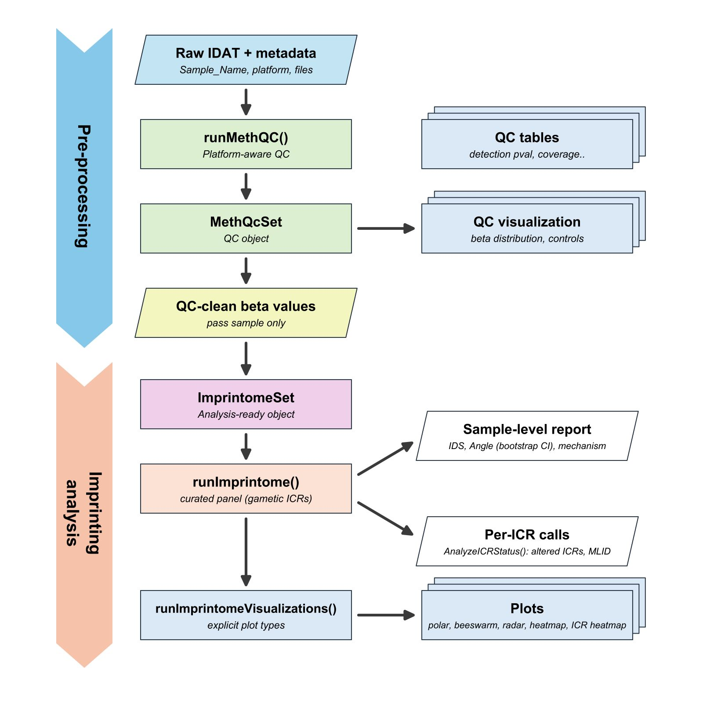

# imprintomeR

**Website:** <https://hongjianjin.github.io/imprintomeR/> (function
reference, vignettes, guides and worked examples)

imprintomeR measures and visualizes genomic imprinting disturbance from
Illumina 450K, EPICv1 and EPICv2 methylation arrays. Starting from IDAT
files, it runs quality control (QC) and preprocessing, then scores each
sample at imprinting control regions (ICRs):

- **Scores:**
  - The Imprinting Deviation Index (IDI), (β − 0.5) × 2, places each
    probe on a −1 to 1 scale, where 0 is the half-methylated state
    expected at an ICR.
  - From the paternal and maternal deviations, the Imprinting Deviation
    Score (IDS) gives each sample’s overall deviation, and the Angle
    gives its direction. Bootstrap uncertainty intervals are optional.
- **Per-ICR calls:** each ICR is scored on its own, with a multi-locus
  summary per sample.
- **Reference centring:** scores can be centred on control samples from
  the same study.
- **Plots:** polar plots (IDS and Angle), radar plots (median IDI per
  ICR), rainfall plots (IDI per probe), beeswarm plots and per-ICR
  heatmaps.

The workflow is built on two S4 classes:

- **MethQcSet:** QC results and preprocessed data for one array
  platform.
- **ImprintomeSet:** scores and annotations, ready for analysis and
  plotting.

Every step can be run from R or with the command-line scripts in
`inst/scripts/` (see the [command-line
guide](https://hongjianjin.github.io/imprintomeR/articles/command-line.html)).

## Table of Contents

- [Installation](#installation)
- [Quick start](#quick-start)
- [Input files](#input-files)
- [Workflow](#workflow)
- [Core Formulas](#core-formulas)
- [Main analysis options](#main-analysis-options)
- [Quality control](#quality-control)
- [Bundled probesets](#bundled-probesets)
- [Plots](#plots)
- [Documentation](#documentation)
- [Test Suite](#test-suite)
- [Maintainers](#maintainers) · [Contact](#contact) ·
  [SessionInfo](#sessioninfo)

## Installation

imprintomeR needs R ≥ 4.1 and imports Bioconductor packages (minfi,
ComplexHeatmap), so install it with BiocManager, which finds both CRAN
and Bioconductor dependencies:

``` r

if (!requireNamespace("BiocManager", quietly = TRUE)) install.packages("BiocManager")
BiocManager::install(c("remotes", "hongjianjin/imprintomeR"))
```

On Linux, Bioconductor packages are compiled from source and need the
curl, OpenSSL and libxml2 development libraries; on Debian or Ubuntu,
install them first with
`sudo apt-get install libcurl4-openssl-dev libssl-dev libxml2-dev`.
`pak::pak("hongjianjin/imprintomeR")` also works. Optional packages
(`Suggests`) are needed only for some functions, which say so when one
is missing.

The annotation files (about 52 MB: probe annotation and the ICR probe
panels, hg19 and hg38) are installed with the package under
`inst/extdata/`; if one is missing, imprintomeR prints a note when it
loads and
[`setup_imprintome_data()`](https://hongjianjin.github.io/imprintomeR/reference/setup_imprintome_data.md)
downloads it.

hg38 (GRCh38) is the default genome; pass `genome = "hg19"` (CLI
`--genome hg19`) for GRCh37 coordinates. Probe IDs, parental-origin
labels and `DMR_type` are the same in both builds for every probe-level
panel except `Jima` (two extra probes in hg38), so scores do not depend
on the build.

## Quick start

Both parts run as pasted (about a minute in all); CI runs this block on
every change.

``` r

library(imprintomeR)

# A. From beta values (QC done elsewhere): the bundled example, GEO GSE52576 (450K, 28 samples)
beta   <- imprintome_example("beta")    # probes x samples
meta   <- imprintome_example("meta")    # Sample_Name, Sample_Group, title, health_state, gender
panels <- readRDS(system.file("extdata", "probesets_hg38.rds", package = "imprintomeR"))
x <- ImprintomeSet(beta = beta, meta = meta, probeset = panels[["selected"]],
                   genome = "hg38", assay = "450K")
x <- runImprintome(x, probeset = "selected", icr = TRUE)
res <- results(x)[["AnalyzeImprintStatus.selected"]]
table(meta$Sample_Group[match(res$Sample_Name, meta$Sample_Name)], res$Mechanism)
plot(x, plot_type = "polar", outFile = "polar.pdf")
export(x, outdir = "imprintome_results", prefix = "GSE52576")

# B. From IDAT files, with QC: example 450K IDATs from Bioconductor (BiocManager::install("minfiData"))
meta  <- minfi::read.metharray.sheet(system.file("extdata", package = "minfiData"))   # adds Basename
qcset <- runMethQC(meta, platform = "450K", outdir = "qc_output", prefix = "minfiData")
export(qcset, outdir = "qc_output", prefix = "minfiData", format = c("xlsx", "rds"))
qcset <- subsetMethQC(qcset, final_qc = "PASS")   # keep samples that passed QC
x <- runImprintome(as.ImprintomeSet(qcset), probeset = "selected")
results(x)[["AnalyzeImprintStatus.selected"]][, c("Sample_Name", "IDS", "Angle", "Status")]
```

In part A, the moles and the leukocytes with paternal uniparental disomy
are called `Pat-Gain+Mat-Loss`, the parthenogenetic cells and the
maternal-disomy sample `Mat-Gain+Pat-Loss`, and the somatic tissues,
placentas and embryonic stem cells normal (`ROI`); sperm, with a
paternal germline pattern, is called `Pat-Gain+Mat-Loss` as expected.

For your own data, see [Input files](#input-files); each step is
described in [Quality
control](https://hongjianjin.github.io/imprintomeR/articles/qc.html) and
[Analysis](https://hongjianjin.github.io/imprintomeR/articles/analysis.html).

## Input files

There are two entry points. Start from IDAT files to run QC with
imprintomeR (part B of the Quick start), or from a beta matrix if QC and
normalization were done elsewhere (part A).

### IDAT files → `runMethQC()`

| Input | Requirement |
|----|----|
| IDAT files | One `_Grn.idat` and one `_Red.idat` file per sample (`.idat.gz` also read), from a 450K, EPICv1 or EPICv2 array. |
| Sample sheet (`data.frame`) | One row per sample. **Required:** `Sample_Name` (unique sample ID, used in every result table) and `Basename` (the IDAT path without the `_Grn.idat`/`_Red.idat` suffix, e.g. `idats/200925700125_R07C01`). **Optional:** `Sample_Group` (groups samples in QC reports and plots; when absent, [`as.ImprintomeSet()`](https://hongjianjin.github.io/imprintomeR/reference/as.ImprintomeSet-MethQcSet-method.md) uses `Sample_Name`), `Donor_ID` (checked against the donors predicted from the SNP probes), `Platform` (filled in by [`check_platform()`](https://hongjianjin.github.io/imprintomeR/reference/check_platform.md)). Other columns are kept and exported. |
| Platform | One platform per [`runMethQC()`](https://hongjianjin.github.io/imprintomeR/reference/runMethQC.md) call: `platform = "450K"`, `"EPIC"` or `"EPICv2"`. For a mixed cohort, run `meta <- check_platform(meta)` and call [`runMethQC()`](https://hongjianjin.github.io/imprintomeR/reference/runMethQC.md) on each platform’s rows. EPICv2 needs the Bioconductor packages `IlluminaHumanMethylationEPICv2manifest` and `IlluminaHumanMethylationEPICv2anno.20a1.hg38`, and [`aggregate_probes()`](https://hongjianjin.github.io/imprintomeR/reference/aggregate_probes-MethQcSet-method.md) before [`as.ImprintomeSet()`](https://hongjianjin.github.io/imprintomeR/reference/as.ImprintomeSet-MethQcSet-method.md). |

[`minfi::read.metharray.sheet()`](https://rdrr.io/pkg/minfi/man/read.metharray.sheet.html)
reads an Illumina sample sheet (CSV) and adds `Basename`; any
`data.frame` with these columns also works. Example:
`minfi::read.metharray.sheet(system.file("extdata", package = "minfiData"))`
(6 samples, 450K).

### Beta matrix → `ImprintomeSet()`

| Input | Requirement |
|----|----|
| Beta matrix | Probes × samples, numeric, values between 0 and 1 (percentages or M-values are rejected with an error). Probe IDs (`cg…`, as on the 450K/EPIC manifests) as row names, or in a first column named `TargetID`, `NAME` or `ID`. Column names are sample IDs. Missing values (`NA`) are allowed. Only probes of the chosen panel are used, so a genome-wide matrix and a panel-only matrix give the same result; for EPICv2, first collapse replicate probes (e.g. `cg06373096_TC11`, `cg06373096_TC12` → `cg06373096`), for example to their median as [`aggregate_probes()`](https://hongjianjin.github.io/imprintomeR/reference/aggregate_probes-MethQcSet-method.md) does for a `MethQcSet`. |
| Metadata (`data.frame`) | **Required:** `Sample_Name` (unique; matched to the beta column names) and `Sample_Group` (or pass `auto_group = TRUE`). Samples present in only one of the two tables are dropped. Other columns are kept and exported. |
| Panel, genome, assay | `probeset`: a panel from `probesets_hg38.rds` / `probesets_hg19.rds` (see [Bundled probesets](#bundled-probesets)); `genome`: `"hg38"` or `"hg19"`; `assay`: the array type (`"450K"`, `"EPICv1"` or `"EPICv2"`), recorded with the results. |

Example files: `imprintome_example("beta", path = TRUE)` and
`imprintome_example("meta", path = TRUE)` are tab-delimited text files
in this layout (782 probes × 28 samples from GEO GSE52576), and can be
passed directly to the command-line script
(`run_imprintomeR.R --beta-file ... --meta-file ...`). For data from
GEO, the
[GSE52576](https://hongjianjin.github.io/imprintomeR/articles/GSE52576.html)
tutorial starts from a series-matrix beta table, and the
[GSE240091](https://hongjianjin.github.io/imprintomeR/articles/GSE240091.html)
tutorial from IDAT files.

## Workflow



    Metadata + IDAT files (one or more platforms)
        ↓
    [check_platform(meta)] → detect the array platform of each sample
        ↓
    Subset meta by platform
        ↓
    [runMethQC(meta_platform)] → read IDATs → normalize beta (noob by default) + detection p-values
                               → QC metrics, Final.QC PASS/FAIL per sample → MethQcSet
        ↓
    [subsetMethQC(qcset, final_qc = "PASS")] → keep passing samples
        ↓
    [aggregate_probes(qcset)] → EPICv2 only: collapse replicate probes (required)
        ↓
    [as.ImprintomeSet(qcset)] → ImprintomeSet with the bundled panels (hg38 by default)
        ↑
        └── or ImprintomeSet(beta, meta, ...) for data already QC-cleaned elsewhere
        ↓
    [runImprintome()] → IDS, Angle and Mechanism per sample
                      (+ per-ICR calls and multi-locus summary with icr = TRUE;
                         bootstrap intervals with n_boot)
        ↓
    [plot() / export()] → plots and result tables

Each `MethQcSet` holds one platform, so cohorts on different arrays are
never merged before QC. In code,
[`check_platform()`](https://hongjianjin.github.io/imprintomeR/reference/check_platform.md),
`runMethQC(platform = )` and the `Platform` column use the values
`"450K"`, `"EPIC"` (EPICv1) and `"EPICv2"`.

## Core Formulas

- Imprinting Deviation Index (**IDI**): (beta - 0.5) × 2
- Imprinting Deviation Score (**IDS**): √((paternal_median - 0.5)² +
  (maternal_median - 0.5)²)
- **Deviation Angle**: atan2(maternal_median - 0.5, paternal_median -
  0.5)
- With a control reference, 0.5 is replaced by each probe’s median beta
  across the controls: paternal/maternal deviations are medians of (beta
  − reference), and IDS and Angle are computed from these deviations
  (see [Reference
  centring](https://hongjianjin.github.io/imprintomeR/articles/analysis.html#reference-centring-and-infinium-design-types)).

The paternal and maternal classes come from the probeset’s `ORIGIN`
annotation, and array beta values are bulk, not allele-specific,
measurements. IDS and Angle are therefore descriptive summaries along
the annotated parental axes, not parent-of-origin calls. The default IDS
cutoff (0.2) and confidence tiers (0.1/0.2/0.4, the `Confidence` column)
are exploratory screening conventions; calibrate them on tissue-matched
controls where possible, and use bootstrap intervals (`n_boot`) to see
which samples are borderline ([Uncertainty and
calibration](https://hongjianjin.github.io/imprintomeR/articles/analysis.html#uncertainty-and-calibration)).
More on the geometry:
[Analysis](https://hongjianjin.github.io/imprintomeR/articles/analysis.html).

### Angle Direction Mapping

Each 45-degree sector of the polar plot is labelled with the direction
of shift along the annotated paternal and maternal axes, such as
paternal gain or maternal loss of methylation, or global hypo- or
hypermethylation. Each label covers the 45° sector centred on the angle
in the table (for example, Pat-Gain covers 337.5° to 22.5°). Samples
with IDS \< 0.2 are labelled ROI (retention of imprinting). The labels
are exploratory directional summaries of bulk beta values, not
parent-of-origin molecular calls; with `n_boot`, `Mechanism_support`
reports how stable a sample’s label is under resampling.

| Angle (°) | Sector (°)    | `Mechanism` label   |
|----------:|---------------|---------------------|
|         0 | 337.5 – 22.5  | `Pat-Gain`          |
|        45 | 22.5 – 67.5   | `Global-Hyper`      |
|        90 | 67.5 – 112.5  | `Mat-Gain`          |
|       135 | 112.5 – 157.5 | `Mat-Gain+Pat-Loss` |
|       180 | 157.5 – 202.5 | `Pat-Loss`          |
|       225 | 202.5 – 247.5 | `Global-Hypo`       |
|       270 | 247.5 – 292.5 | `Mat-Loss`          |
|       315 | 292.5 – 337.5 | `Pat-Gain+Mat-Loss` |

## Main analysis options

[`runImprintome()`](https://hongjianjin.github.io/imprintomeR/reference/runImprintome.md)
arguments (command-line flags of `run_imprintomeR.R` in brackets).
Details and examples:
[Analysis](https://hongjianjin.github.io/imprintomeR/articles/analysis.html).

| Argument | Default | What it does |
|----|----|----|
| `probeset` \[`--probeset`\] | `"selected"` | Probe panel to score (see [Bundled probesets](#bundled-probesets)) |
| `dmr_type` \[`--dmr-type`\] | gametic ICRs for `selected` | `"all"` scores every probe; `"secondary"` reports secondary DMRs separately |
| `reference_group` / `reference_beta` \[`--reference-group` / `--reference-file`\] | fixed 0.5 | Centre scores on in-cohort or external tissue-matched controls ([Reference centring](https://hongjianjin.github.io/imprintomeR/articles/analysis.html#reference-centring-and-infinium-design-types)) |
| `infinium_type` \[`--infinium-type`\] | all probes | `"balanced"` averages type I and type II deviations |
| `icr` \[`--icr`\] | `FALSE` | Adds per-ICR calls, the multi-locus summary and the `icr_heatmap` plot ([Per-ICR scores](https://hongjianjin.github.io/imprintomeR/articles/analysis.html#per-icr-scores-and-icr-balanced-ids)) |
| `delta_cutoff`, `z_cutoff` | 0.175, 2 | Per-ICR call thresholds used with `icr = TRUE` (z needs controls) |
| `balance` \[`--balance icr`\] | probe-pooled | `"icr"` weights each ICR equally in IDS/Angle |
| `n_boot`, `n_perm` \[`--n-boot`, `--n-perm`\] | 0 | Bootstrap intervals, `Mechanism_support` and `Status_interval` (interval above, below or spanning the cutoff) (`resample_reference = TRUE` also resamples in-cohort controls); exploratory origin permutation test, ICR-level by default (control reference only) ([Uncertainty](https://hongjianjin.github.io/imprintomeR/articles/analysis.html#uncertainty-and-calibration)) |
| `ids_cutoff` \[`--ids-cutoff`\] | 0.2 | IDS below which a sample is `Normal` with `Mechanism` ROI; [`CalibrateIDS()`](https://hongjianjin.github.io/imprintomeR/reference/CalibrateIDS.md) derives a cohort cutoff from controls |

## Quality control

[`runMethQC()`](https://hongjianjin.github.io/imprintomeR/reference/runMethQC.md)
marks each sample `Final.QC = "PASS"` when both hold:

1.  at least 95% of probes are detected at p \< `pcutoff` (default 0.05;
    `runMethQC(..., pcutoff = )` or `run_meth_QC.R --pcutoff`);
2.  the Bisulfite Conversion I Green and Red control-probe metrics are
    both at least 1 (`CtrlMetrics.QC`); if the control probes cannot be
    read, only criterion 1 applies.

The control-probe metrics, SNP sample-swap check and predicted donor IDs
follow the [ewastools](https://github.com/hhhh5/ewastools) methods
(Heiss and Just, 2018) and give the same results as ewastools 1.8.2,
without needing it installed.

All other metrics (other control metrics, intensities, predicted sex,
SNP contamination, donor IDs) are reported, not used. Beta values are
noob-normalized by default (`"noob_swan"` and `"raw"` are alternatives).
Normalization, QC tables, plots and export files: [Quality
control](https://hongjianjin.github.io/imprintomeR/articles/qc.html).

## Bundled probesets

`probesets_hg19.rds` and `probesets_hg38.rds` hold the same eleven
panels: the probe-level `Jima`, `Joshi`, `Court`, `Rosenski`,
`selected`, `NanoImprint`, `chr11p15` and `chr20q13` (GNAS) panels, and
the region-level `Rosenski_region`, `chr11p15_region` and
`chr20q13_region`. Every probe-level panel carries parental-origin
(`ORIGIN`), `ICR_name`, `DMR_type` (following Monk et al., 2018) and
Infinium design type.

`selected`, the default, keeps the probes present in at least two of
`Court`, `Jima`, `Joshi` and `Rosenski` that are on the 450K array and
on EPICv1 and/or EPICv2: 782 probes, all on 450K, 742 on EPICv1 and 683
on EPICv2. How the panels and `selected` were built, with the platform
table:
[Probesets](https://hongjianjin.github.io/imprintomeR/articles/probesets.html).

## Plots

`plot(x, plot_type = ...)` on an `ImprintomeSet`:

| Plot type | Shows |
|----|----|
| `polar` (and `auto`) | IDS and Angle of every sample |
| `radar` | Median IDI of each ICR, one sample |
| `rainfall` | IDI of each probe along the genome, one sample |
| `beeswarm`, `beeswarm_origin`, `beeswarm_chr` | Probe beta values by sample, by parental origin, or by chromosome |
| `mirror_density` | Maternal vs paternal beta distributions |
| `violin` | Beta distribution of each sample |
| `heatmap_by_probe`, `heatmap_by_gene`, `circular_heatmap`, `cor_heatmap` | Probe, gene, circular and sample-correlation heatmaps |
| `icr_heatmap` | Per-ICR deviations, samples × ICRs (after `runImprintome(icr = TRUE)`) |

``` r

p <- plot(x, plot_type = "polar", result_name = "AnalyzeImprintStatus.selected",
          colorColumn = "Sample_Group", outFile = "polar.pdf")
x <- runImprintomeVisualizations(x, plot_types = "default", probeset = "selected")
```

Colours by parental origin follow the `ORIGIN` annotation (legend
“Annotated parental origin”), not allele-specific measurements. QC plots
on a `MethQcSet` take `type =` instead of `plot_type =`. All plot types
with examples:
[Plots](https://hongjianjin.github.io/imprintomeR/articles/plots.html).

## Documentation

All guides, vignettes and the function reference are on the
[website](https://hongjianjin.github.io/imprintomeR/); the sources of
the guides are in `vignettes/articles/`.

- [Quality
  control](https://hongjianjin.github.io/imprintomeR/articles/qc.html):
  QC preprocessing, normalization, QC tables, merging and export files
- [Analysis](https://hongjianjin.github.io/imprintomeR/articles/analysis.html):
  `ImprintomeSet`, scoring options, reference centring, per-ICR calls,
  uncertainty and calibration, export
- [Plots](https://hongjianjin.github.io/imprintomeR/articles/plots.html):
  all plot types with examples
- [Probesets](https://hongjianjin.github.io/imprintomeR/articles/probesets.html):
  bundled panels, how `selected` was built, platform coverage
- [FAQ](https://hongjianjin.github.io/imprintomeR/articles/faq.html):
  choosing an IDS cutoff and interpreting results (control references,
  bootstrap intervals, `Mechanism_support`, per-ICR calls, the
  multi-locus flag)
- [Command-line
  guide](https://hongjianjin.github.io/imprintomeR/articles/command-line.html):
  command-line QC and analysis
- R vignettes:
  [`vignette("imprintomeset-quickstart")`](https://hongjianjin.github.io/imprintomeR/articles/imprintomeset-quickstart.md),
  [`vignette("imprintomeset-results-export")`](https://hongjianjin.github.io/imprintomeR/articles/imprintomeset-results-export.md),
  [`vignette("imprintomeR-workflow-basic")`](https://hongjianjin.github.io/imprintomeR/articles/imprintomeR-workflow-basic.md)
  (core functions without S4 objects)
- [Supplementary_Code.R](https://github.com/hongjianjin/imprintomeR/blob/main/supplementary/Supplementary_Code.R):
  companion script to the Supplementary Workflow Examples of the
  Application Note; runs every example on public data (minfiData IDATs
  and the bundled GSE52576 example) in about 3 minutes, and is run by CI
  on Linux, macOS and Windows
- Worked GEO examples (guides in `vignettes/articles/`, with run
  notebooks and their outputs in `tutorials/`):
  - GSE52576
    ([guide](https://hongjianjin.github.io/imprintomeR/articles/GSE52576.html),
    [notebook](https://github.com/hongjianjin/imprintomeR/blob/main/tutorials/GSE52576.ipynb)):
    androgenetic and parthenogenetic samples
  - GSE240091
    ([guide](https://hongjianjin.github.io/imprintomeR/articles/GSE240091.html),
    [notebook](https://github.com/hongjianjin/imprintomeR/blob/main/tutorials/GSE240091.ipynb)):
    QC and analysis of an EPIC cohort
  - GSE74738
    ([guide](https://hongjianjin.github.io/imprintomeR/articles/GSE74738.html),
    [notebook](https://github.com/hongjianjin/imprintomeR/blob/main/tutorials/GSE74738.ipynb)):
    450K placentas scored against their own controls, with per-ICR
    calls, bootstrap intervals, the origin permutation test and a
    control-calibrated cutoff

## Test Suite

The testthat suite (`tests/testthat/`) covers the S4 classes, QC,
normalization, probeset annotation, genome routing, scoring, reference
centring, per-ICR calls, uncertainty, plotting and export:
`devtools::test("path/to/imprintomeR")`.

## Maintainers

- **Hongjian Jin** (maintainer), <hongjian.jin@stjude.org>, ORCID
  [0000-0003-3833-7170](https://orcid.org/0000-0003-3833-7170)

Center for Applied Bioinformatics, St. Jude Children’s Research
Hospital, Memphis, TN 38105, USA.

## Contact

- **Bug reports, questions and feature requests:** open an issue at
  <https://github.com/hongjianjin/imprintomeR/issues>, with the
  imprintomeR version (`packageVersion("imprintomeR")`), the command or
  code you ran and the error message.
- **Other enquiries:** email the maintainer, Hongjian Jin
  (<hongjian.jin@stjude.org>).
- **Citing imprintomeR:** use the “Cite this repository” button on
  GitHub (from `CITATION.cff`) or the Zenodo DOI
  [10.5281/zenodo.23741652](https://doi.org/10.5281/zenodo.23741652).

## SessionInfo

The R session used to build and test imprintomeR 1.5.0 (R 4.3.3), with
the versions of the declared dependencies, is recorded in
[tutorials/sessionInfo.md](https://github.com/hongjianjin/imprintomeR/blob/main/tutorials/sessionInfo.md).
Since then, ewastools and Vennerable have been removed as dependencies,
and cowplot, pheatmap and Rtsne moved to `Suggests`.
